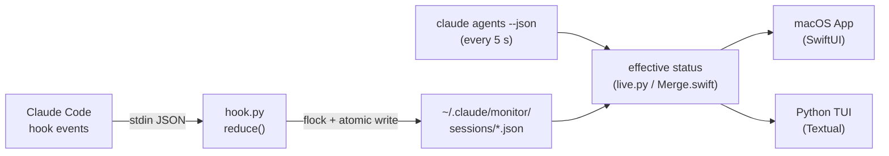
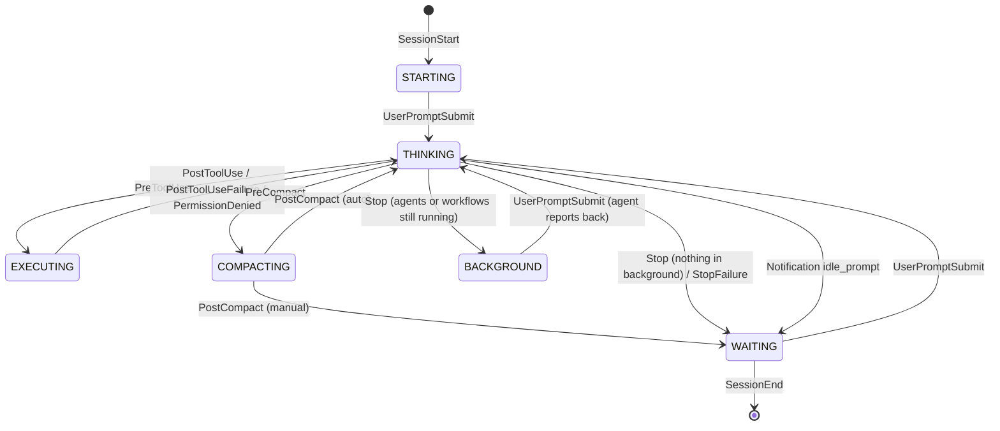

# Claude Monitor

Real-time monitoring of active Claude Code sessions, with dual interface: **TUI** (terminal) and **native macOS app** with menu bar.

## Overview

When working with multiple Claude Code sessions in parallel, it's easy to lose track of which session is waiting for input, which requires permissions, and which is still processing. Claude Monitor combines two sources into one dashboard:

- **Hooks** — Claude Code lifecycle events, written by `claude-monitor hook` to one JSON file per session. They carry the detail: current tool, prompt, title, model, effort, subagents, background work.
- **Live data** — `claude agents --json`, Claude Code's own list of running sessions. It says which sessions are alive, their exact PID, and whether Claude Code is waiting on the user — things hooks can't always tell (an Esc fires no `Stop`, a sandbox prompt fires no `PermissionRequest`, `claude -p` kills async hooks on exit).

Both interfaces share the same state and can run simultaneously:

- **Python TUI** — terminal interface built on [Textual](https://textual.textualize.io), lightweight and portable
- **macOS App** — native SwiftUI application with main window, menu bar icon, Dock badge, and attention notifications

Requires **Claude Code 2.1.251 or later** (`PostModelSwitch`); `claude-monitor install` warns on older versions.

## Architecture



### Architectural patterns

| Pattern | Detail |
|---|---|
| **Event-driven** | 18 Claude Code hook events reduced into a session state (`hook.reduce`, a pure function) |
| **File-based IPC** | JSON files in `~/.claude/monitor/sessions/` (override with `CLAUDE_MONITOR_DIR`) |
| **Atomic writes** | Temp file in `monitor/.tmp/` + `os.replace()`: watchers never see a half-written file |
| **Concurrency-safe writes** | One advisory `flock` serializes every read-modify-write; parallel async hooks (a workflow fires dozens at once) never drop updates |
| **Two clocks** | `status_ts` orders main-status changes; subagent and metadata events never move it, so an out-of-order event can't regress the status or swallow a `Stop` |
| **Per-agent prompts** | `pending` maps `"main"` or an `agent_id` to the prompt it raised; PERMISSION is derived from it |
| **Live reconciliation** | `claude agents --json` (fallback: `~/.claude/sessions/*.json`) corrects the hook status and supplies PIDs |
| **Hide, don't delete** | The UIs never delete files of live sessions; the hook garbage-collects files of dead sessions on `SessionStart` |

## Project structure

```
claude-monitor/
├── pyproject.toml                          # Python packaging (hatchling)
├── src/claude_monitor/
│   ├── main.py                             # CLI: install/uninstall hooks, launch TUI
│   ├── hook.py                             # Hook events → session state (pure reducer)
│   ├── state.py                            # Session model, schema 2, storage, GC
│   ├── live.py                             # claude agents --json, merge rules, stop/kill
│   ├── labels.py                           # Model / mode / limit / token labels
│   ├── usage.py                            # Plan usage fetch (throttled)
│   └── tui.py                              # Textual TUI
├── tests/                                  # unittest suite + fixtures shared with Swift
│
└── ClaudeMonitor/
    ├── Package.swift                       # Swift Package Manager (+ test target)
    ├── Tests/ClaudeMonitorTests/           # XCTest over the shared fixtures
    └── ClaudeMonitor/
        ├── ClaudeMonitorApp.swift          # Entry point, WindowGroup + MenuBarExtra
        ├── AppDelegate.swift               # Badge reset on focus
        ├── Labels.swift                    # Mirror of labels.py
        ├── Merge.swift                     # LiveEntry, LiveSnapshot, mirror of live.effective()
        ├── Models/                         # Session (schema 1 + 2), SessionStatus, Usage, JSONValue, IdeLockFile
        ├── Views/                          # SessionTableView, MenuBarView
        └── Services/                       # SessionStore, LiveSessions (claude agents --json), DirectoryMonitor
```

## Session states

| Status | Meaning |
|---|---|
| `STARTING` | Session started or resumed, no prompt yet |
| `THINKING` | A turn is running |
| `EXECUTING` | The main agent is running a tool |
| `PERMISSION` | Someone — the main agent or a subagent — waits for the user (permission, plan approval, question, MCP input). Derived from `pending` |
| `COMPACTING` | Conversation compaction in progress |
| `BACKGROUND` | The turn ended but background agents or workflows are still running; Claude will continue on its own. Shown as `WAITING` after 30 min without agent activity |
| `WAITING` | Idle, the user's turn |



`PERMISSION` sits on top of any of these: a prompt adds an entry to `pending`, and the entry is removed when that agent's call finishes, when the same agent starts a different call 3 s or more later (the prompt was denied), on `SubagentStop`, on the main agent's `Stop`/prompt, or on `idle_prompt`.

### Hook events

| Hook event | Effect | Notes |
|---|---|---|
| `SessionStart` | `STARTING` | Records the model. `source: compact` keeps the status; other sources reset subagents, prompts and errors. Runs the GC of dead sessions' files |
| `UserPromptSubmit` | `THINKING` | Human prompts become the topic. Prompts Claude Code submits itself (`<task-notification>`, `<agent-message>`, `<teammate-message>`, `<cross-session-message>`) don't. `session_title` sets the custom title |
| `PreToolUse` | `EXECUTING` | `ExitPlanMode` / `AskUserQuestion` also add a pending prompt |
| `PermissionRequest` | pending prompt | Late deliveries (after the call finished or the turn ended) are ignored, using a fingerprint of `tool_input` |
| `PermissionDenied` | `THINKING` | Auto mode refused the call; the tool never runs |
| `PostToolUse` / `PostToolUseFailure` | `THINKING` | Counts the tool and resolves its prompt |
| `Stop` | `WAITING` or `BACKGROUND` | `background_tasks` decides: active subagents, workflows or teammates mean `BACKGROUND` (shells and monitors don't) |
| `StopFailure` | `WAITING` | Stores `error` (`rate_limit`, `overloaded`, …) as `last_error` until the next prompt |
| `SessionEnd` | *(file removed)* | Registered **synchronously** so `claude -p` can't kill it on exit |
| `Notification` | — | `idle_prompt` → `WAITING` and clears prompts and agents (since 2.1.288 it fires only when nothing runs); `permission_prompt` while `EXECUTING` → pending prompt (sandbox network prompt) |
| `SubagentStart` / `SubagentStop` | — | Maintains the subagent list (description from Claude Code's agent metadata) |
| `Elicitation` / `ElicitationResult` | pending prompt / resolved | MCP server waiting on the user |
| `PreCompact` / `PostCompact` | `COMPACTING` / back | |
| `PostModelSwitch` | — | `/model`, `opusplan`, automatic fallback: updates the model |

Every event fired **inside a subagent** carries `agent_id` and only updates that subagent's row (current tool, tool count, its prompts): it never changes the session's status, tool, tool count, cwd, mode or effort. Late events from an agent that already stopped are ignored.

At turn boundaries the hook reads the transcript tail (64 KB, growing to 1 MB) for the AI title, the last human prompt, the model actually used (when `SessionStart` didn't say) and the context size.

### Effective status (hook state + live data)

Applied by `live.effective()` (TUI) and `Merge.effective` (app), tested against the same `tests/fixtures/merge_cases.json`. Live data counts only if it is **fresh**: observed more than 2 s after the hook's last transition and its newest prompt, from a snapshot under 15 s old.

| Live (fresh) | Hook status | Shown |
|---|---|---|
| `waiting` (except `dialog open`) | any | `PERMISSION` (detail: `waitingFor`) |
| `idle` | `THINKING` / `EXECUTING` / `STARTING` / `COMPACTING`, or a main prompt | `WAITING` |
| `busy` | `WAITING` / `STARTING` | `THINKING` |
| `idle` / `busy` | anything else | hook status without its stale prompts (`BACKGROUND` kept) |
| not listed | activity in the last 90 s | hook status |
| not listed | silent for 90 s | hidden |
| no fresh snapshot | any | hook status; active statuses silent for an hour are hidden |

Live sessions without a state file (hooks not installed, `--restricted`, settings excluded) appear as **untracked** rows. `WAITING` sessions idle for more than 4 hours, and untracked idle ones, are hidden unless "show idle" is on.

## Session data format

Each session is saved to `~/.claude/monitor/sessions/{session_id}.json` (schema 2; `status`, `title`, `last_updated` and `subagents[].status` are derived, so schema-1 readers keep working):

```json
{
  "schema": 2,
  "session_id": "abc-123",
  "cwd": "/path/to/project",
  "project": "my-project",
  "status": "PERMISSION",
  "base_status": "EXECUTING",
  "status_ts": 1791702455.25,
  "activity_ts": 1791702460.5,
  "last_updated": "2026-10-11T07:07:40.500000+00:00",
  "tool_name": "Bash",
  "permission_mode": "auto",
  "model": "claude-opus-5-5",
  "effort": "max",
  "context_tokens": 412345,
  "topic": "Fix the flaky test",
  "title": "flaky-test",
  "custom_title": "flaky-test",
  "ai_title": "Flaky test fix",
  "tool_count": 12,
  "started_at": "2026-10-11T07:07:34.767302+00:00",
  "pending": {"a72b09f1ce480cbcf": {"tool": "Bash", "fp": "ffeeddccbbaa", "since": 1791702459.0}},
  "last_error": "",
  "background": {"active": 2, "types": {"subagent": 2, "shell": 1}},
  "crons": 1,
  "subagents": [
    {
      "agent_id": "a72b09f1ce480cbcf",
      "agent_type": "Explore",
      "description": "Changelog analysis",
      "status": "permission",
      "tool_name": "Read",
      "tool_count": 5,
      "ts": 1791702459.0
    }
  ],
  "subagents_overflow": 0
}
```

Text fields are capped at 500 characters and the subagent list at 64 entries (`subagents_overflow` counts the rest). The full writer output is in `tests/fixtures/session_v2.json`.

## Notifications (macOS app)

| Transition (effective status) | Action |
|---|---|
| Enter `PERMISSION` | Dock bounce (critical attention request) |
| Exit `PERMISSION` | Cancel bounce |
| Enter `WAITING` from an active status | Increment Dock badge (not from `STARTING`) |
| Exit `WAITING` | Decrement Dock badge |
| App gains focus | Reset badge to zero |

## Usage bar

The usage hook reads the OAuth token (macOS Keychain, then `~/.claude/.credentials.json`) and fetches `api/oauth/usage` at most every 90 s across all sessions, backing off on 429 (honouring `Retry-After`) and 401. Both UIs show the `limits[]` array — the model-scoped weekly limit is labelled with its model, e.g. "Week (Fable)" — and fall back to the flat `five_hour` / `seven_day` windows.

## Requirements

### Python TUI

- Python >= 3.10
- `textual >= 3.0`
- `click >= 8.0`

### macOS App

- macOS 15+ (Sequoia)
- Swift 6.0+
- Xcode (for building)

Both use the `claude` CLI for live data (`~/.local/bin`, `/opt/homebrew/bin`, `/usr/local/bin`, or `CLAUDE_MONITOR_CLAUDE_BIN`); without it they fall back to `~/.claude/sessions/`, then to hooks only.

## Installation and usage

### Python TUI

```bash
# Install the package
pip install -e .

# Register hooks in ~/.claude/settings.json (safe to re-run after upgrades)
claude-monitor install

# Launch the monitor
claude-monitor

# Remove hooks
claude-monitor uninstall
```

**TUI shortcuts:** `q` quit, `r` refresh, `i` show/hide idle sessions, `k` stop the selected session (`claude stop` for background sessions, SIGTERM otherwise), `K` force kill (SIGKILL), `y` copy `claude --resume <id>`, `c` remove files of dead sessions older than 1 hour. Stop and kill ask for confirmation and re-check the PID first.

### macOS App

```bash
cd ClaudeMonitor
./run.sh
```

The app launches with a main window and a menu bar icon. It reads `~/.claude/monitor/sessions/` (requires the hooks) and polls `claude agents --json`.

## Tests

```bash
PYTHONPATH=src python3 -m unittest discover -s tests -v   # Python
(cd ClaudeMonitor && swift test)                          # Swift: same fixtures
(cd ClaudeMonitor && CLAUDE_MONITOR_LIVE_TEST=1 swift test --filter LiveSessionsTests)  # opt-in: real `claude agents --json`
```

`tests/make_fixtures.py` regenerates the session-file fixtures from the real writer. `tests/fixtures/real_headless_session.jsonl` holds hook payloads recorded from a real `claude -p` run (2.1.296) and is replayed by the reducer tests.
